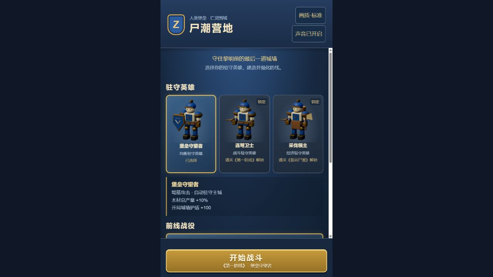
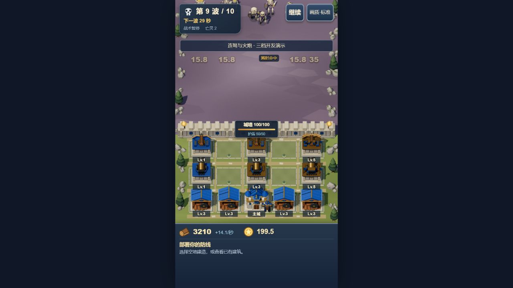

# Three.js 最终战斗反馈与桌面候选记录

日期：2026-10-11。实际候选代码 e1981030d00198646520da6ad6147ef9e0d0feee；本地普通合入 8b365782c3644182b037b527bf002e5f83763d0d。此记录补充已交付的 THREEJS_PRODUCT_POLISHED_GAME_EVIDENCE.md，不代替实体手机或项目所有者接受。

## 玩家现在得到什么

正式入口为 Three.js 游戏：三名可解锁英雄、10/12/15 波三关战役、5×3 营地、六类可建建筑与主城、Lv.1–5 成长和词条、五类普通/精英亡灵及两种 Boss，包含暂停、静音、胜负、再战、返回和进度保存。蓝金堡垒与紫灰亡灵使用 33 件正式 GLB；上一批精修的箭塔、伐木屋、主城和骷髅已进入游戏。本次保留全部源资产与规则。

本次完成的产品修正：真实伤害≥15 的飘字、按类别节流的命中/技能提示、暂停冻结反馈、在实际字宽与 HUD 安全范围内错开提示；亡灵君王名称统一。场景退出现在释放 renderer 对共享几何、材质、纹理的使用，保留可复用的 CPU 模型缓存，并关闭退出场景的 WebGL 上下文。

## 实际候选与画面

生产构建冻结为 final-feedback-game-dist-v4，46 文件与该版本构建逐一匹配；33 件 GLB 与上一批精修版本 SHA-256 全部一致。审计见 evidence/final-feedback/final-feedback-freeze-audit-v4.json。正式入口 http://127.0.0.1:5364/Game-ZCamp/ ，私有检查端口 5365。两个 origin 的进度分开，正式试玩入口保留新玩家解锁流程。

命中画面来自已有 siege 开发演示，经合法建造/升级命令准备，然后真实时间运行；35 与 15.8 来自实际伤害。最终五个可见提示 DOM 矩形两两交叠为 0，暂停 step=15508；切低画质后同一步数与提示保留。该截图不能当作自然经营进度，演示标签保留。

## 桌面持续战斗

实机 Windows 11 10.0.26300 / i7-12700KF / RTX 4060 Ti；Chrome 155，1280×720，原生及标准渲染 DPR 1.5。使用完整冻结生产产物与既有 dev=pressure 入口。HP 10 亿及攻墙伤害 0 用于维持活动量，其余移动、攻击、减速、链电、Boss 行为沿用正式规则；这不是正式波次配置。

| 活动量 | 实测时间 | 帧样本 | 中位数 | P95 | 最大 | 完成/中断 |
| --- | --- | --- | --- | --- | --- | --- |
| 100 | 15.0001秒 | 2150 | 6.9ms | 7ms | 21ms | 完成/无 |
| 200 | 300.0013秒 | 42387 | 6.9ms | 7ms | 41.7ms | 完成/无 |
| 300 | 60.0002秒 | 8040 | 6.9ms | 13.8ms | 62.4ms | 完成/无 |

各场景活动量全程等于目标，15 格建筑持续真实攻击，包含全部五类普通/精英与两种 Boss。200 场景实际响应检查两次，下一帧分别 5.3/4.4ms；300 场景一次下一帧 11.5ms；均实际选择雷电塔并显示详情。300 的 P95 上升，最大 62.4ms；此桌面条件下没有观察到崩溃或操作失效。200/300 控制台警告和错误均为 0。

完整原始 rAF 数组已保存，final-statistics-audit.json 独立复算样本数、中位数、nearest-rank P95、最大与总时长，全部相符。逐秒资源、绘制调用、三角数、模型/动画/特效数量与浏览器可获取堆指标在原始 JSON。末帧 200：1095 calls / 3149502 triangles；300：789 / 4470422。末帧只是不同攻击时刻，不可直接比较负载。rAF 包含浏览器调度及全部工作，无独立 CPU/GPU 时间；计数与 JS 全页堆不代表 GPU 字节。

## 三英雄三关与重复游玩

最终代码实际执行十轮“开始→回放防守→真实胜利结算→再战→回放失守→真实失败结算→返回”。使用已有公开开发回放、seed=1337 与合法命令，按原规则加速；不宣称十场全程真实时间人工游玩。覆盖三英雄×三关全部九个组合并复测终局；胜利路径正式三关峰值分别 7–9、11、13–14，全部运行到最后一波。记录包含失败路径峰值、模拟步数、有效时间与命令数。

11 个大厅快照均为 geometry=3、texture=10、cachedAssets=33、rendererUsers=1、canvas=1；音频上下文首次出战建立后保持 1。JS used heap 在约 79.2–93.2MB 间非单调波动。共享 CPU 缓存故意保留；资源所有权释放由对应回归和独立审查验证，不宣称测到了整机 GPU 字节。刷新后英雄/关卡已解锁，末次选择和通关保存；实际静音按钮显示声音已关闭。见 final-lifecycle-10-cycles.json 与 final-campaign-reload-and-mute.txt。

## 审查与剩余接受项

完整迁移的 Spec 与 Standards 各发现一项实质遗漏（战斗反馈、renderer 资源所有权）；本次已修复。定向审查确认两项关闭，随后名称与提示排版复审均 0 findings。对应四份审查报告随证据保存。源码工作树 check/build 通过；根合入检查与安装日志见 final-feedback-merge.md。Windows npm ci 曾因预览占用原生 Rollup 文件失败，不能把该次安装写为通过。

#12 的桌面候选要求有本次完整实测支持。#5/#13/#1 保留开放：iQOO Z10 Turbo 已登记并连接同 Wi-Fi，但旧手机短测不是本次正式混编版本、200 记录曾被后台打断且无 300 数据；本次不宣称真机通过。最终实体触控/安全区/后台、200 五分钟、300 操作及项目所有者美术接受仍需补齐。遵照所有者产品优先指令，不扩张测试平台、不要求先重跑手机长测，不自动发布网站或合入 master。

## 项目所有者验收更新（2026-10-11）

项目所有者在当前正式候选中完成《第一防线》10 波通关，并明确确认当前状态可接受。该确认覆盖当前玩法、Three.js 低模风格、营地与亡灵的可读性、建筑升级与词条、战斗反馈和胜负流程，已同步记录在 Issue #5、Issue #13 与 PR #14 的评论中。

这次确认完成了玩法与美术样板的人工接受；它不替代实体 iQOO Z10 Turbo 在当前混编候选上的 200 单位连续 5 分钟、300 单位可操作性和触控/后台记录。旧手机记录中 200 单位曾 page-hidden 中断、300 单位缺失，因此 #5/#13 仍按真实证据边界保持开放。

截图证据：docs/production/evidence/final-feedback/owner-acceptance-10-wave.png。

## 浏览器产品回归（2026-10-11）

按项目所有者“先交付游戏、手机验收后置”的调整，在本地正式候选 `http://127.0.0.1:5364/Game-ZCamp/` 进行真实 UI 回归。流程覆盖：大厅选择可出战英雄与已解锁第二关；进入《第一防线》；15 个营地格位可访问；空格建造箭塔与木材厂；箭塔升级及词条三选一；暂停期间建造并恢复战斗；失败结算、再战/返回营地；返回大厅后英雄与关卡选择仍可用。实际观察到资源扣费、产出、等级、词条、城墙/护盾和波次状态均随操作更新。

同步执行 `npm test -- --run`：27 个测试文件、172 个测试全部通过；`npm run build` 完成 TypeScript 检查与 Vite 生产构建。此次回归没有改变玩法数值或存档键。实体手机取证按所有者指示暂缓，#5/#13 继续保持开放，不将浏览器回归当作真机通过。

追加检查（2026-10-11）：npm run check 通过，包含 TypeScript 类型检查、27 个 Vitest 文件/172 个测试，以及 4 个采集器协议测试。采集器测试只验证本地证据接收协议，不构成实体手机验收。

补充刷新回归（2026-10-11）：重新加载无参数正式入口后，已保存的连弩卫士与《裂谷尸潮》选择恢复，第三关仍显示锁定，模型资源加载完成后可直接开始战斗。
